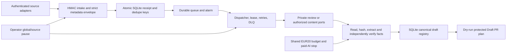

# Archelaos event-driven brain — ISS-108

Owner: Codex. One implementation branch/PR: `codex/brain-core-staging` / [#111](https://github.com/dizigs/archelaos-site/pull/111).
Specifications and ownership: [#108](https://github.com/dizigs/archelaos-site/issues/108).
Verified stage handoffs: [#71](https://github.com/dizigs/archelaos-site/issues/71).

This is an executable staging candidate, with real local Cloudflare `workerd`,
SQLite Durable Objects, persisted alarms and HTTP integration tests. It is **not
a verified remote deployment**. Workers access is blocked by the existing token's
permissions. No production automation, DNS, billing, secret or public content is
changed by this package. Existing periodic news research remains scheduled.



## Run the actual checks

```sh
npm ci --prefix brain --ignore-scripts --no-audit --no-fund
npm run syntax --prefix brain
npm test --prefix brain
python -m unittest discover -s brain/test -p '*_test.py' -v
```

`miniflare`, `workerd` and Wrangler versions are pinned by a real npm lockfile.
Node24 is used by the read-only PR workflow. Tests use temporary SQLite stores,
fresh runtime instances, concurrent callers and injected synthetic integration
ports. Provider calls are blocked/instrumented; test doubles are explicitly named
and never reported as real Google, GitHub, Sheet or Cloudflare deployment success.
The workflow publishes actual numeric TAP counts in a check annotation, avoiding
dependence on access to downloadable Actions log archives.

Wrangler compilation is a credential-free `deploy --dry-run`. The checked-in
configuration expires in1970 and contains no keys, so an accidental deployment
cannot accept work. A future authorized deployment must inject the exact source
SHA, a bounded expiry, separate intake/operator keys and verified free-tier
entitlement. This preparation does not create those credentials or resources.

## Implemented boundaries

- Intake: strict4KiB envelope, HMAC-SHA256 over method/path/timestamp/raw body,
  five-minute signature window, opaque source/revision SHA256, UUID event and
  correlation IDs, allowlisted metadata only. Real source identifiers are resolved
  privately by adapters, not copied into public receipts/logs.
- Dedupe: independent delivery, authoritative revision and content-hash keys;
  inconsistent reuse returns409. Concurrent/redelivered events share one durable
  job. The complete validated metadata envelope survives for later consumers.
- Queue: receipt acknowledgement follows the SQLite transaction; wake-up precedes
  receipt/claim commits; lease recovery, maximum3 dispatch attempts, bounded
  exponential backoff, DLQ and quarantine. No added cron/polling loop.
- Controls: separate operator HMAC key, durable global/per-source pause,
  revision-CAS and exact-version storage-health prerequisites for explicit resume.
  Pause is checked before intake/dispatch and before each consumer stage. It does
  not delete receipts, historical evidence or pending work. Paid AI cannot be
  resumed in this candidate.
- Limits:30 intake deliveries/source/minute,1000/day,2000 retained jobs and20000
  alias keys. Capacity exhaustion fails closed instead of silently deleting
  evidence. Retention/archival requires a separate reviewed operational policy.
- Status and audit: authenticated receipt inspection, bounded audit projections,
  correlation IDs, fixed reason codes and SHA attribution; no raw source text,
  secret headers, prompts, email fields or private document URLs in public logs.

## Prepared source ports — disabled until authorized

| Source | Implemented offline boundary | Real activation still required |
|---|---|---|
| Shared Drive | Channel/resource/token/expiry verification; approved Drive scope; authoritative changes feed; SQLite cursor/lease; checkpoint after durable deliveries; crash/replay and removal quarantine | Approved OAuth/service identity, initial cursor, real `changes.watch`, renewal/reconciliation and source-event proof |
| Gmail | Pub/Sub envelope decoder; injected cryptographic OIDC verifier contract; pinned audience/service identity/mailbox/subscription/label; history/page-token distinction and expired-history block | Authorized push subscription and mailbox watch, real OIDC verification/JWK SDK, watch renewal and approved-message proof |
| Contributions | Independent committed backend receipt, processing consent, clean malware scan and content hash; private review by default | Actual upload/receipt backend and approved consent/data handling; browser success alone is insufficient |
| GitHub | Raw webhook HMAC, immutable repository scope, delivery dedupe, CI failure filtering, fork/private review and self-loop suppression | Configured webhook and approved processing permissions; no code execution or merge from an event |
| Content | Authorized read/hash, structured extraction or injected PDF extractor, independent fact registry, unambiguous canonical person mapping, history/Hall/stories/news draft targets | Real authorized readers/extractors and curated public-release fact/identity registry |

The adapters do not request Google permissions, register channels, read a mailbox,
receive all ChatGPT conversations or update a private Sheet merely by existing.
Metadata hashes are not substitutes for actual file hashes. Unsupported extraction,
ambiguous identity, another club's attribution, private source or unverified
provenance returns `PRIVATE_REVIEW` with no public draft.

## Content and publication

`dispatch_service.mjs` connects a retained native queue envelope to authorized
reader/extractor/fact/identity ports, a SQLite work journal and the draft registry.
Concurrent consumers produce one logical result; interrupted claims are bounded
and require lease/reconciliation rather than blindly repeating effects.

Public text is built from independently approved registry facts, never document
instructions or an unverified model answer. Existing event IDs are preserved.
Preview/result phases update one canonical draft; stale previews cannot downgrade
a result. No existing biographies, news files, pagination or design are edited.

The publisher produces a protected **Draft PR plan** by default. Only an explicitly
marked synthetic test double can exercise the create/reuse port. `mock://` output
is simulation, not a GitHub PR. Real content publication is deliberately disabled
until source authorization, staging evidence and review requirements are met.

## AI ceiling and its actual guarantee

Money is integer **microEUR**:1EUR =1000000 units, monthly maximum20000000.
The month follows Europe/Athens. One shared SQLite ledger covers all configured
providers/operations, with atomic maximum-token reservations, model/price and FX
verification, event/revision/operation binding, once-only call claims,75/90percent
alerts and idempotent actual-usage settlement. Unknown billing outcomes retain
reservations. Prior-month records are not erased; settlement remains attributed
to the original month and a new month has its own ceiling.

`ai_gateway.mjs` refuses missing coverage/privacy, paused automation, unknown/live
provider setup, unavailable ledger/alerts and duplicate or ambiguous attempts
before calling its explicitly synthetic provider port. There is no real model
transport or production AI credential here. The existing optional site AI Worker
is untouched. Account-wide external billing cannot be guaranteed until every paid
path/account and bounded provider billing are verified; charged AI remains OFF.

## Remaining operational gates

Remote Workers/Durable Objects deployment and real provider logs remain BLOCKED;
see [ACCESS.md](docs/ACCESS.md). Source watch/receipt/webhook permissions, tracker
connector, real PDF/OCR extraction, live content PR publishing and provider choice
remain explicit setup/integration gates. No mock/local result closes those gates.
See [WORK_LOG.md](WORK_LOG.md) for DONE / IN_PROGRESS / BLOCKED / NEXT checkpoints.
